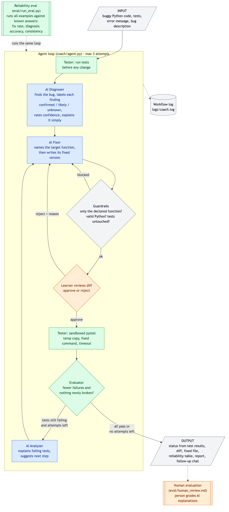

# 🩺 AI Debugging Coach

An AI assistant that helps beginner Python programmers **understand, fix, and
verify** bugs, instead of just handing them replacement code.

You give it broken code, plus an error message, failing tests, or a
description like *"the secret number changes every time I click Submit."*
The coach:

- diagnoses the bug and explains it in plain language
- proposes a minimal patch and shows you the diff
- runs the tests in a sandbox
- keeps trying, up to three attempts, until the tests pass or it can explain
  what is still wrong
- finishes with an educational report

**Why it matters:** beginners who paste errors into a chatbot often get back
a rewritten program they don't understand, with no proof that it works. This
coach teaches the concept behind the bug and proves the fix with tests. It
never says "fixed" just because the AI claims it.

> **Design principle:** the AI proposes and reasons; controlled application
> logic validates and executes.

## Original project

This project extends **Game Glitch Investigator: The Impossible Guesser**
(codepath-project-1, Modules 1-3). That project was a Streamlit
number-guessing game that had been "written by an AI" and shipped full of
bugs: hints that pointed the wrong way, a secret number that reset on every
click, and broken scoring. My job was to play it, find and document the bugs,
fix them, move the game logic into `logic_utils.py`, and add pytest
regression tests.

That work is preserved in [`original_project/`](original_project/). Its
original bugs are now the coach's main demo in
[`examples/number_guessing_game/`](examples/number_guessing_game/). In other
words, the coach automates and explains the debugging process I did by hand
in Project 1.

## Architecture overview



Mermaid source: [`diagrams/architecture.mmd`](diagrams/architecture.mmd).
In the diagram, blue is the AI, green is a testing check, and orange is a
human check.

**Input → process → output:**

1. **Input:** the learner gives code, optional tests, an error message and a
   description, or picks a built-in example.
2. **Tester (baseline):** the tests run before anything changes, so the coach
   knows which tests fail.
3. **AI Diagnoser:** the model finds the bug and labels each finding
   *confirmed* (directly shown by the code or test output), *likely* or
   *unknown*. It also rates its confidence and explains the concept for a
   beginner.
4. **AI Fixer:** the model must first name the function and lines it will
   change, then write the new version of each of those functions.
5. **Guardrails:** the app swaps in only the declared functions, located with
   Python's own parser, and blocks patches that touch test files or contain
   anything other than the declared function.
6. **Human check:** the learner sees the diff and approves or rejects it,
   with a reason, before anything runs.
7. **Tester (sandboxed pytest)** and **Evaluator:** a patch is kept only if
   it reduces failures without breaking a test that passed before.
8. **AI Analyzer:** if tests still fail, the model explains what each failure
   means, and the loop retries with that feedback (at most 3 attempts).
9. **Output:** a final status computed from test results, the diff, the
   fixed file, a reliability table, a report and a follow-up chat.

Two more checks sit outside the loop. The **reliability eval** runs the
whole system on known-bug examples and scores it. **Human evaluation** grades
the quality of the AI's explanations.

| Component | File |
|---|---|
| Agent loop (state machine, keep/discard rule, final status) | [`coach/agent.py`](coach/agent.py) |
| Patch guardrails and diffs | [`coach/workspace.py`](coach/workspace.py) |
| Sandboxed test runner | [`coach/runner.py`](coach/runner.py) |
| AI model calls (local Ollama or Claude), prompts, structured output schemas | [`coach/llm.py`](coach/llm.py), [`coach/prompts.py`](coach/prompts.py), [`coach/schemas.py`](coach/schemas.py) |
| Report and reliability table | [`coach/report.py`](coach/report.py) |
| Web UI / command line | [`app.py`](app.py) / [`coach/__main__.py`](coach/__main__.py) |
| Reliability evaluation / human evaluation | [`eval/run_eval.py`](eval/run_eval.py) / [`eval/human_review.md`](eval/human_review.md) |

## Setup

**The project is free to run.** By default the AI is
[Qwen2.5-Coder 3B](https://ollama.com/library/qwen2.5-coder), an open coding
model that runs on your own computer through [Ollama](https://ollama.com). No
account, API key or payment is needed, and your code never leaves your
machine. You need **Python 3.10+** and about **2 GB of free disk space**.

**1. Install Ollama and download the model** (one time):

```bash
brew install ollama                # macOS; Windows/Linux installers: https://ollama.com/download
ollama serve                       # leave this running in its own terminal tab
ollama pull qwen2.5-coder:3b       # in a second tab; about 1.9 GB
```

**2. Install the project:**

```bash
git clone https://github.com/stimalsina141/applied-ai-system-project.git
cd applied-ai-system-project

python3 -m venv .venv
source .venv/bin/activate          # Windows: .venv\Scripts\activate
pip install -r requirements.txt
```

That's it; no `.env` file is required. Optional settings (model, attempts,
test timeout) are listed in [`.env.example`](.env.example). With 16 GB of RAM
or more, `COACH_MODEL=qwen2.5-coder:7b` is noticeably smarter. The code also
supports the paid Claude API (`COACH_PROVIDER=claude` plus an
`ANTHROPIC_API_KEY`), but nothing in this README requires it.

### Run the web app

```bash
streamlit run app.py
```

1. Pick a **built-in example** (start with *Number guessing game*), or choose
   **Paste my own code** and add pytest tests if you can.
2. Describe what is going wrong, then click **Start debugging**.
3. Read the diagnosis and explanation, then click **Propose a fix**.
4. Review the diff, then **Approve and run tests** or **Reject** with a
   reason.
5. Read the report, download the fixed file, and ask follow-up questions.

To let the coach run the whole loop without pausing, turn on **Run
automatically** in the sidebar. Patches still only run in the sandbox.

### Run from the command line

```bash
python -m coach --list
python -m coach --example number_guessing_game
python -m coach --code my_script.py --tests test_my_script.py --symptom "add(2, 3) returns -1"
```

### Run the tests and the evaluation

```bash
pytest                               # offline, no model needed
python -m eval.run_eval --runs 2     # scores the real AI on every example (about 30 min locally)
```

## Sample interactions

These are real outputs from the free local model (`qwen2.5-coder:3b`),
lightly trimmed. The full transcripts are in
[`eval/results/transcripts/20261116-200650/`](eval/results/transcripts/20261116-200650/).

### End to end from the command line

```bash
$ python -m coach --example grade_calculator
```

```text
Debugging Grade calculator (session d8f22fe2)...

--- Attempt 1: grades.py ---
@@ -1,19 +1,17 @@
 def letter_grade(score):
-    """Turn a 0-100 score into a letter. 90 and above is an A."""
-    if score > 90:
+    if score >= 90:
         ...
 def class_average(scores):
-    total = 0
-    for i in range(1, len(scores)):
-        total += scores[i]
+    if not scores:
+        return 0
+    total = sum(scores)
     return total / len(scores)

# Debugging Report

**Status:** Fixed
**Why it stopped:** All tests pass.
**Attempts used:** 1 of 3

## Root cause
The condition score > 90 is not inclusive, so a score of 90 is not correctly
identified as an 'A'. The class_average function is also incorrect ...
Confidence: high

## Validation
- Before: 3 passed, 6 failed in 0.24s
- After: 9 passed in 0.46s

| Check                      | Result                                                        |
|----------------------------|---------------------------------------------------------------|
| Original bug addressed     | 6 of 6 failing tests now pass                                 |
| Existing tests preserved   | 3 of 3 still pass                                             |
| Full test suite            | 9 passed in 0.46s                                             |
| Unrelated behavior changed | Not detected by the 9 provided tests (only the declared       |
|                            | functions changed)                                            |

## Remaining concerns
None found by the 9 provided tests. Inputs and behavior the tests don't
cover were not checked.
```

The exit code is 0 only when the status is **Fixed**, so the command can be
used in scripts.

### 1. Grade calculator: fixed on the first try

**Input:**

> A student who scored exactly 90 got a B instead of an A, and the class
> average comes out lower than it should.

**Baseline:** 3 passed, 6 failed.

**Diagnosis** (confidence: high):
- **Confirmed** `letter_grade` (lines 3-11): returns 'B' for a score of 90.
- **Confirmed** `class_average` (lines 13-19): calculates the average incorrectly.

**Explanation shown to the learner:**

> The condition score > 90 is exclusive, meaning it does not include 90...
> [class_average] starts the loop from index 1, which means it does not
> include the first score in the sum. This results in an incorrect average.

**Patch (attempt 1):**

```diff
-    if score > 90:
+    if score >= 90:
     ...
-    total = 0
-    for i in range(1, len(scores)):
-        total += scores[i]
+    total = sum(scores)
```

**Result:** **Fixed.** 9 of 9 tests pass. The fix is correct, but it also
deleted both docstrings and changed `"A"` to `'A'`. That's not minimal, and
the learner sees it in the diff before approving.

### 2. Number guessing game: the Project 1 state bug, partially fixed

**Input** (4 files, 2 of them protected test files):

> The secret number changes every time I click Submit. The hints also seem
> to point the wrong way, my score sometimes goes up after a wrong guess, and
> New Game doesn't fully restart.

**Baseline:** 11 passed, 17 failed.

**Diagnosis** (confidence: high): confirmed findings in `init_game`,
`check_guess` and `update_score`. It missed `new_game`, so 3 of 4 buggy
functions were found.

**What happened:** attempts 1 and 2 were **blocked by the guardrail**
because the model's new code was not a single complete `init_game`
function. Attempt 3 found the real root cause of the bug I spent the most
time on in Project 1:

```diff
-    state["secret"] = rng.randint(low, high)
+    if 'secret' not in state:
+        state['secret'] = rng.randint(low, high)
```

**Result:** **Partially fixed.** 12 passed, 16 failed. The patch was kept
because failures dropped and nothing broke. The report lists all 16
remaining failures (reversed hints, scoring) as unresolved. It does not
claim success.

### 3. Shopping cart: a regression caught and thrown away

**Input:**

> A brand new cart already contains items from the previous customer. Also,
> a 10% discount on a $200 order only takes off $10.

**Baseline:** 2 passed, 2 failed.

**What happened:**
1. **Attempt 1:** blocked, because the new code had a syntax error (`'{'
   was never closed`).
2. **Attempt 2:** the textbook fix for the mutable default argument. **Kept**
   (2 failures went to 1):

   ```diff
   -def add_item(name, price, cart=[]):
   +def add_item(name, price, cart=None):
   +    if cart is None:
   +        cart = []
   ```
3. **Attempt 3:** replaced that with `cart = []`, which broke
   `test_add_to_existing_cart`. **Discarded automatically**, so the good
   attempt 2 code stayed.

**Result:** **Partially fixed.** 3 passed, 1 failed. The discount bug in
`cart_total` was diagnosed but never patched.

### Guardrails and the evaluator in action

Real behavior from the runs above and from hands-on testing:

| Input | What the AI did | What the system did | Result |
|---|---|---|---|
| Shopping cart, attempt 1 | Wrote a new `add_item` with an unclosed `{` | Guardrail: *"the new code has a syntax error on line 4: '{' was never closed"* | Blocked before running; counted as an attempt |
| Number guessing game, attempts 1–2 | Returned code that wasn't a single complete `init_game` function | Guardrail: *"`new_code` must be the complete function, starting with `def init_game(`, and nothing else"* | Blocked; attempt 3 produced a valid fix |
| Shopping cart, attempt 3 | Replaced the correct `cart=None` fix with `cart = []` | Evaluator: *"it broke 1 test(s) that passed before: test_add_to_existing_cart"* | Discarded; the earlier good fix was kept |
| `add(2, 3) == 6`, a test that can never pass (max 2 attempts) | Proposed `a + b` twice | Evaluator: *"no improvement (1 failing before and after)"* | **Unable to fix** after 2 of 2, never "Fixed" |
| Code pasted with no tests | Proposed a fix | No tests means no proof | **Not verified**, never "Fixed" |
| Code example that contains the fix | Put the fixed function in its "small example" | The app hides code examples until the fix has been tested | The learner sees the explanation first |

## Design decisions

| Decision | Why | Trade-off |
|---|---|---|
| **Test results decide the status, not the AI** | An AI that says "fixed" is not proof. Only pytest can mark a session Fixed. | Without tests, the coach can only say "not verified", which is honest but less satisfying. |
| **Structured outputs** for every AI step | Each answer must match a Pydantic schema, so the app can check targets, edits and recommendations before acting. | Less free-form than chat, and schemas take effort to design. |
| **Declare the target, then edit inside it** | Forces the AI to locate the bug before fixing it, and blocks unrelated edits. | Occasionally rejects a valid fix that spans two functions; the AI then has to declare both. |
| **Free local model (Ollama) by default** | Anyone can run the project at no cost, offline, without sending code to a company. | A 3B model on a laptop is far weaker and slower (1-3 min per session) than a paid frontier model, which the eval numbers show. |
| **Edits replace a whole declared function** | The app finds the function with Python's parser and swaps only its lines, so an edit can't spill outside it. My first design used find/replace text, but the small model kept mis-copying quotes, and all 3 attempts were blocked. | The model rewrites the full function, so it can also change lines it shouldn't (the diff shows this, and the learner can reject it). |
| **Keep a patch only if it helps and breaks nothing** | Partial progress is kept, and regressions are thrown away automatically. | A patch that fixes the bug but needs a later test update is discarded. |
| **Sandbox copy, fixed `pytest` command, no file writes** | The AI can never run commands or change the learner's files. | The learner downloads and applies the fix themselves. |
| **Human approval by default** | The learner reads every change before it runs, which is part of the learning. | Slower than auto mode, which is still available. |
| **A single agent with a fixed loop** | Easy to test, predictable and explainable. | Less flexible than a multi-agent system, but that was out of scope. |
| **Python only, small projects (≤10 files, 60 KB)** | Keeps the first version reliable and affordable. | Can't debug whole repositories. |

## Testing summary

**Automated tests: 106 of 106 pass** (`pytest`, about 20 s, offline). The AI is replaced with a scripted fake model, so these tests check
the system around the AI deterministically:

- The agent loop: fixed on the first try, retry after failure, stop at 3
  attempts, discard a patch that breaks a passing test, partial fixes, the
  no-tests mode, and AI service failures
- Guardrails: edits to test files, new code that isn't the declared function,
  syntax errors in a patch, unsafe paths, empty input
- The local model client (with HTTP faked): schema sent, one correction
  round for invalid JSON, friendly errors when Ollama isn't running
- The sandbox runner: pass/fail parsing, syntax errors, an infinite loop
  hitting the timeout, and API keys hidden from test code
- Every example fails as shipped, and its reference solution passes (5 of 5)
- The Streamlit UI, driven headlessly: the full review flow, Run
  automatically, stopping at the attempt limit, bad input and syntax errors,
  and hiding code examples until the fix is tested
- The learner's files on disk are byte-for-byte unchanged after a fix

**Reliability evaluation of the real AI** (`python -m eval.run_eval --runs 2`,
5 examples × 2 runs, `qwen2.5-coder:3b`, full results in
[`eval/results/latest.md`](eval/results/latest.md)):

> **Summary:** the model was good at *finding* bugs but weak at *fixing* them.
>
> - **Locating bugs:** it pointed at the right functions 90% of the time (93% precision).
> - **Fixing:** only 2 of 10 runs reached all tests passing (both grade-calculator runs). The other 8 ended *Partially fixed*: every one improved at least one test, and none broke a passing test.
> - **Guardrails:** they blocked 6 bad patches before they ran (syntax errors, malformed functions), and the keep/discard rule threw away a patch that broke a passing test.
> - **Confidence:** the model said "high" confidence on all 10 runs, including the 8 it did not fully fix, so its confidence is useless as a signal.
> - **Consistency:** repeated runs reached the same status 100% of the time and pointed at the same functions on 4 of 5 examples. The exception was the
  word counter, where one run missed the double-space bug in `word_count`.

| | |
|---|---|
| Fix rate (all tests pass) | 20% (2 / 10) |
| Runs that improved the tests | 100% (10 / 10) |
| Diagnosis recall / precision | 90% / 93% |
| Mean attempts | 2.6 of 3 |
| Patches blocked by guardrails | 6 |
| Changes outside declared functions | 0 |

The evaluation measures:

| Metric | What it measures |
|---|---|
| Fix rate | Share of runs where all tests pass at the end, judged by pytest |
| Diagnosis recall / precision | Whether the AI pointed at the functions that really contain the bugs |
| Fix rate by confidence | Whether the AI's "high / medium / low" confidence matches how often it succeeds |
| Consistency | With `--runs 3`, how often repeated runs agree on the status and the bug location |
| Attempts and guardrail blocks | How many tries it needed and how often a patch was rejected before running |

**Human evaluation:** [`eval/human_review.md`](eval/human_review.md) is a
table of inputs, criteria and results. All 20 application-behavior checks
pass. A person grades the AI's explanations from the saved transcripts, and
reading them turned up problems the numbers hide: a temperature explanation
that contradicts itself, a finding labeled "Confirmed" that was false, and
explanations that give away the fix.

**Hands-on testing:** I also used the app as a learner, starting with an
`average([])` crash. That one session found six issues:
- the explanation gave away the fix
- prose rendered inside a code block
- the report claimed "Not detected" when it meant "not detected *by your
  tests*"
- a test-driven choice (return 0) was presented as the only answer
- an abstract root cause ("undefined in mathematics")
- a confusing attempts slider

Five are fixed in the app and covered by tests (section 3 of the review
table). The sixth, the root-cause wording, I fixed with a prompt rule and
then **reverted**: the same rule made the grade calculator fail 3 of 3 runs
after it had been fixed 2 of 2. The re-test also exposed problems I couldn't
fix in code: the model failed an `is_even` logic bug, and it gave confidently
wrong answers to a follow-up question.

**What worked:** separating "the AI proposes" from "the app decides" made
the system testable. Every rule (keep/discard, final status, guardrails) is
plain Python with a unit test.

**What didn't:**
- The original Project 1 state bug lived in top-level Streamlit script code,
  which pytest cannot exercise. To make it testable, I moved the game-state
  logic into functions (`init_game`, `new_game`) that take a plain dict in
  place of `st.session_state`.
- Pasted code without tests is a real gap. The coach can only say "not
  verified."
- Automated checks can't judge whether an explanation is clear to a beginner.
  That needs the human review table.
- The free 3B model is the weakest link. It usually fixes one bug per
  session and then repeats itself. Its failure analysis often just says
  "Retry the patch," which gives the next attempt nothing to work with.
- The small model is fragile to prompt wording. One extra sentence in the
  system prompt flipped two examples, one from fixed to failing and the
  other from failing to fixed. Any prompt change has to be re-checked with
  the evaluation script, not just one manual try.
- Follow-up chat answers aren't checked by anything. When asked "What if the
  list contains None?", the model said `sum()` returns 0, but it actually
  raises `TypeError`.
- My first patch format (copy the exact text to find, then replace it)
  failed on every attempt with the small model, so I redesigned it (see
  Design decisions).

**What I learned:** the hardest part of an AI system is not the prompt but
the checks around it. Deciding what counts as proof, and making the AI's
output something code can verify, mattered more than the wording of any
prompt.

## Guardrails and logging

| Risk | Guardrail |
|---|---|
| AI runs arbitrary commands | The only command ever run is `python -m pytest` with fixed arguments, without a shell |
| AI modifies your files | Patches stay in memory, tests run on a temporary copy, and you download the fix yourself |
| Runaway code | Tests time out after 30 seconds |
| Secrets leak to test code | `ANTHROPIC_*`, `OPENAI_*`, `AWS_*` and similar variables are removed from the test environment |
| AI "fixes" the tests instead of the code | Test files are protected |
| Unrelated edits | Only the declared functions' lines are replaced, and the new code must be exactly that function |
| Endless retries | At most 3 attempts; blocked and rejected patches count too |
| Prompt injection in user code | The system prompt treats code, tests and test output as data, not instructions |

> **Only debug code you wrote or trust.** Tests run your code on your own
> computer. The temporary folder and timeout prevent accidents, but they are
> not a security sandbox against deliberately malicious code.

Every session logs its key events to `logs/coach.log`, and the same events
appear in the app's **Workflow log** panel. The log holds file names, counts
and short summaries only, never source code or keys:

```text
INFO    [d8f22fe2] Session started: Grade calculator. 2 files (grades.py, tests/test_grades.py), 1 test file, max 3 attempts
INFO    [d8f22fe2] Baseline: 3 passed, 6 failed in 0.24s
INFO    [d8f22fe2] Diagnosis generated: Conditional statements and loops (confidence high; 2 confirmed, 0 likely, 0 unknown)
INFO    [d8f22fe2] Attempt 1: patch proposed for grades.py:class_average, grades.py:letter_grade (+12 -14 lines)
INFO    [d8f22fe2] Attempt 1: approved, running pytest
INFO    [d8f22fe2] Attempt 1: 9 passed in 0.46s
INFO    [d8f22fe2] Attempt 1: patch kept (all tests pass)
INFO    [d8f22fe2] Final status: Fixed. All tests pass.
```

Full per-attempt traces (plan, diff, guardrail decision, test result,
keep/discard reason and failure analysis) are saved for every evaluation run
and collected in [`ai_interactions.md`](ai_interactions.md).

## Project structure

```text
app.py                  Streamlit UI
coach/                  Agent, workspace/guardrails, runner, LLM, prompts, schemas, report, logging
examples/               Five buggy example projects (code + tests + solution/)
eval/                   Reliability evaluation, human review table, saved results
tests/                  Offline test suite for the coach
diagrams/               Mermaid architecture source
assets/                 Rendered architecture image
original_project/       codepath-project-1, preserved
model_card.md           Limitations, misuse, testing surprises, AI collaboration
ai_interactions.md      The agent's saved reasoning traces (decision chain per attempt)
```

## Reflection

This project changed how I think about building with AI. In Project 1, I was
the one checking an AI's work, finding where code it had confidently written
was wrong. Building the coach meant designing that skepticism into the
software: the AI has to show evidence, label its guesses, point at the code
before touching it, and let tests decide whether it succeeded. The best
problem-solving habit here was the same one I used when debugging by hand:
reproduce the problem first, make one small change, and verify it before
moving on.

*My responsible-AI reflection (how I collaborated with AI, the suggestions I
accepted and rejected, and the system's limitations) is in
[`model_card.md`](model_card.md).*
